# Talamander liveries for Nuclear Option

Twelve custom aircraft liveries for [Nuclear Option](https://store.steampowered.com/app/2168680/Nuclear_Option/), made by Talamander. They cover seven aircraft. They were built with Shockfront's official livery SDK, and every one was checked in the game.

This is a fan mod. It is not made, endorsed or supported by Shockfront Studios.

**Download:** [latest release](https://github.com/Talamander/nuclear-option-liveries/releases/latest). Take `Talamander-Liveries-v1.0.0-all.zip` for everything, or one of the per-aircraft zips.

## The liveries

All previews are screenshots from the game itself.

| Preview | Livery | Aircraft | Folder | In-game name |
|---|---|---|---|---|
| 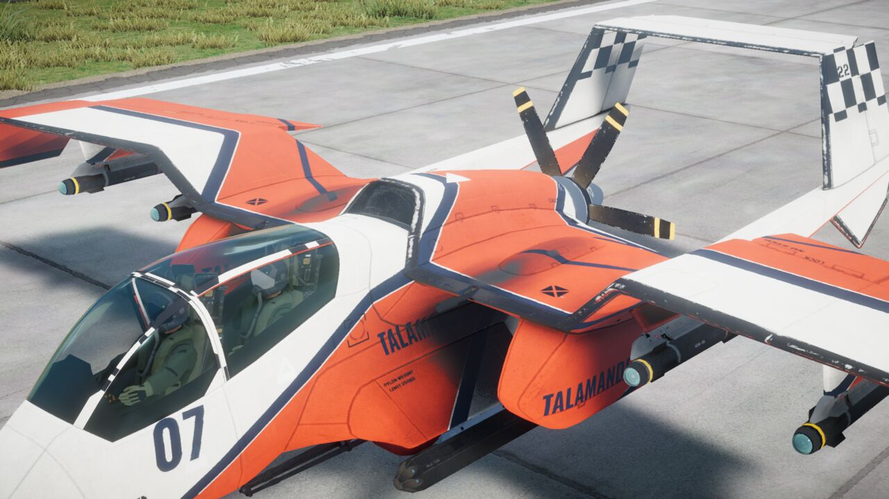 | **Sorrel Racer**: off-white and red race scheme with navy pinstripes, a big "07", "TALAMANDER RACING" on the sides and checkered fins. | CI-22 Cricket | `TAL_Cricket_SorrelRacer` | Talamander Sorrel Racer |
| 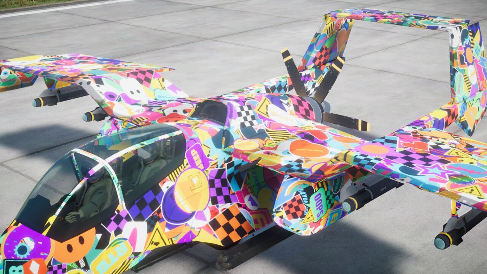 | **Sticker Bomb**: the whole airframe covered in about 3,300 overlapping vinyl stickers. | CI-22 Cricket | `TAL_Cricket_StickerBomb` | Talamander Sticker Bomb |
| 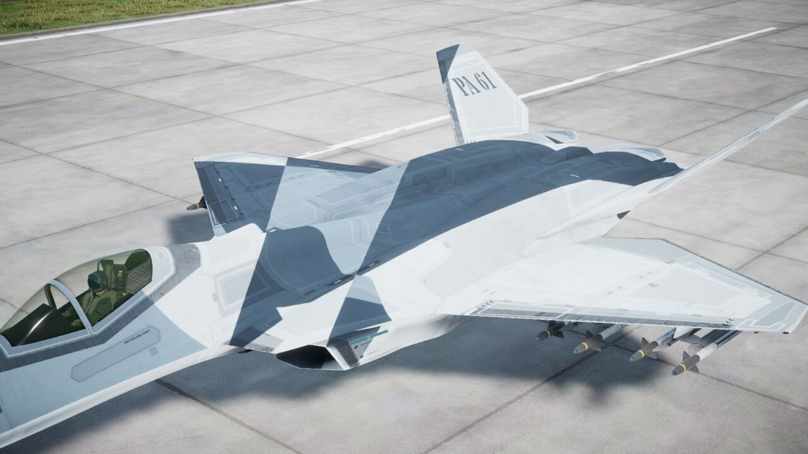 | **Glacier Splinter**: three-grey splinter camouflage with a light belly, "PA 61" stencilled on the fins and "PORT ANSEL" on the intakes. | KR-67 Ifrit | `TAL_Ifrit_GlacierSplinter` | Talamander Glacier Splinter |
| 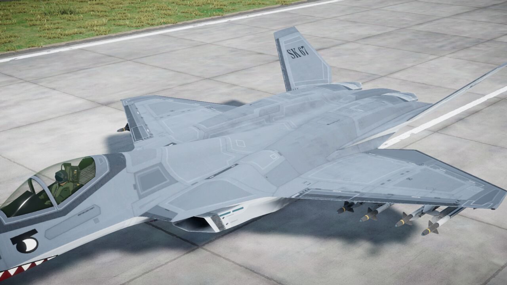 | **Shark Mouth**: grey with a shark mouth and eye on the nose and "SK 67" on the fins. | KR-67 Ifrit | `TAL_Ifrit_SharkMouth` | Talamander Shark Mouth |
| 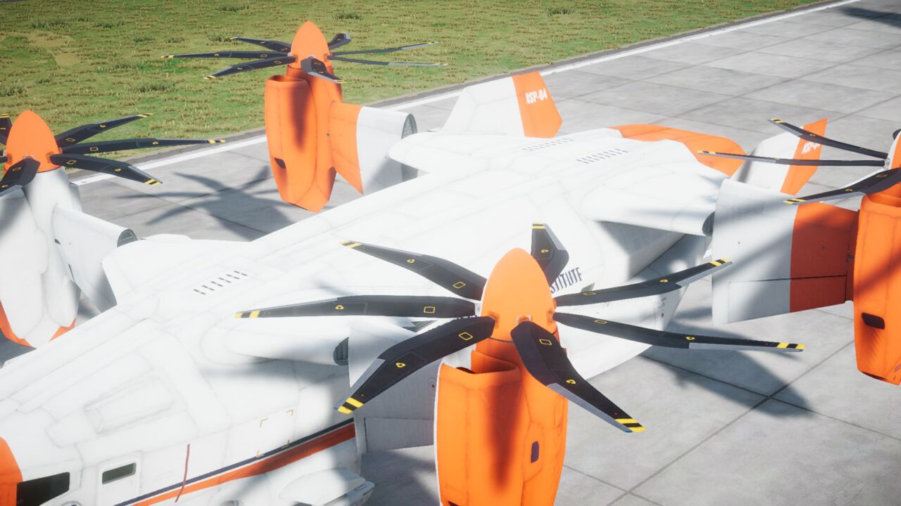 | **Arctic Research**: white polar-research scheme with an international orange nose, tail and outer wings, a navy cheatline, "NORTH SOUND POLAR INSTITUTE" and "NSP-04". | VL-49 Tarantula | `TAL_Tarantula_ArcticResearch` | Talamander Arctic Research |
| 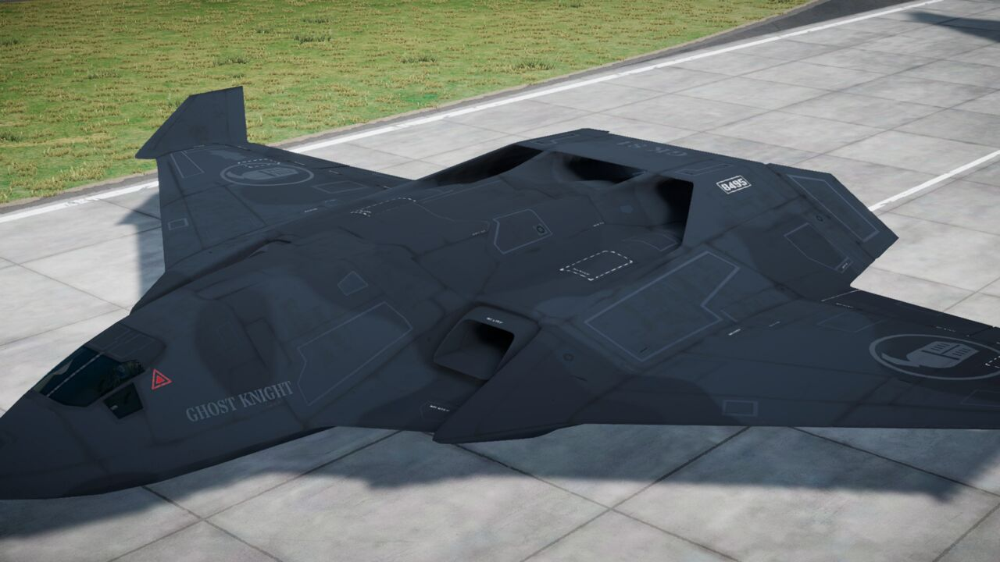 | **Ghost Knight**: near-black night scheme with a low-visibility knight helm emblem on the wings and "GK 81". | SFB-81 Darkreach | `TAL_Darkreach_GhostKnight` | Talamander Ghost Knight |
| 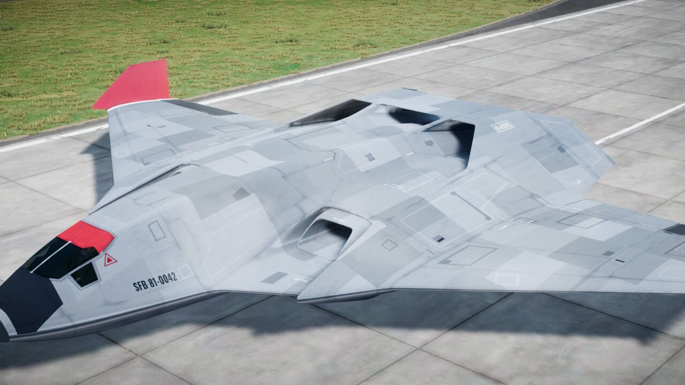 | **Polished Bare Metal**: natural metal finish with painted-in sky and ground reflections, panel shading, red wingtips and "SFB 81-0042". | SFB-81 Darkreach | `TAL_Darkreach_BareMetal` | Talamander Polished Bare Metal |
| 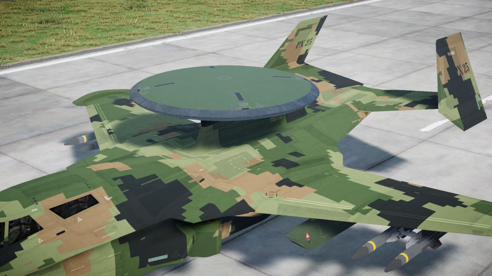 | **Digital Pixel Camo**: woodland pixel camouflage with "PX 25". | EW-25 Medusa | `TAL_Medusa_DigitalCamo` | Talamander Digital Pixel Camo |
| 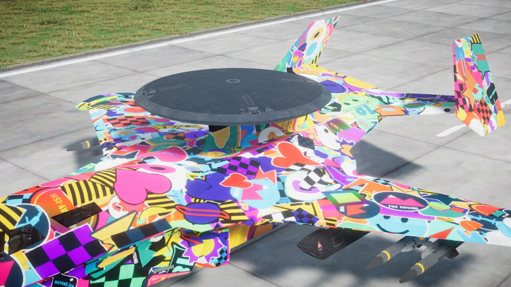 | **Sticker Bomb**: full sticker coverage, about 2,150 stickers. | EW-25 Medusa | `TAL_Medusa_StickerBomb` | Talamander Sticker Bomb |
| 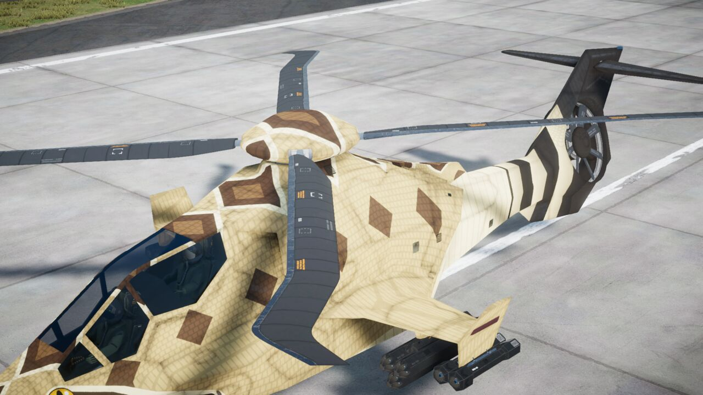 | **Rattlesnake**: sand diamondback pattern, a banded tail boom and a snake eye. | SAH-46 Chicane | `TAL_Chicane_Rattlesnake` | Talamander Rattlesnake |
| 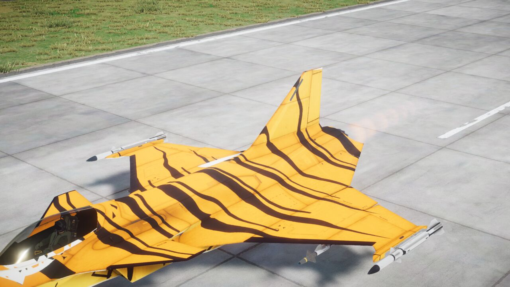 | **Tiger Meet**: orange with tapered black tiger stripes. | FS-12 Revoker | `TAL_Revoker_TigerMeet` | Talamander Tiger Meet |
| 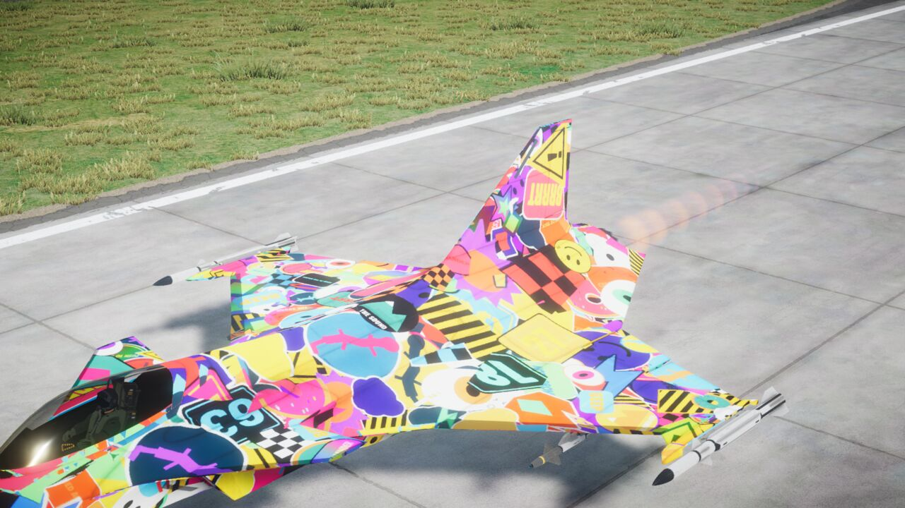 | **Sticker Bomb**: full sticker coverage, about 1,060 stickers. | FS-12 Revoker | `TAL_Revoker_StickerBomb` | Talamander Sticker Bomb |

The sticker designs, emblems, numbers and place names are all made up. The Sticker Bomb liveries have the same name on every aircraft; the game only lists the one that fits the aircraft you picked.

## Downloads

Each zip holds livery folders that go straight into the game's `Skins` folder.

| File | Contents |
|---|---|
| `Talamander-Liveries-v1.0.0-all.zip` | All 12 liveries |
| `Talamander-Liveries-v1.0.0-Cricket.zip` | Sorrel Racer, Sticker Bomb |
| `Talamander-Liveries-v1.0.0-Ifrit.zip` | Glacier Splinter, Shark Mouth |
| `Talamander-Liveries-v1.0.0-Tarantula.zip` | Arctic Research |
| `Talamander-Liveries-v1.0.0-Darkreach.zip` | Ghost Knight, Polished Bare Metal |
| `Talamander-Liveries-v1.0.0-Medusa.zip` | Digital Pixel Camo, Sticker Bomb |
| `Talamander-Liveries-v1.0.0-Chicane.zip` | Rattlesnake |
| `Talamander-Liveries-v1.0.0-Revoker.zip` | Tiger Meet, Sticker Bomb |

`SHA256SUMS.txt` on the release page lists the checksum of every zip.

## Install

You do not need any mod loader. The game reads custom liveries from its own app data folder.

### Windows

1. Close the game.
2. Press Win+R, paste the path below and press Enter:

   ```
   %USERPROFILE%\AppData\LocalLow\Shockfront\NuclearOption\Skins\
   ```

   If Windows says the `Skins` folder does not exist, open `%USERPROFILE%\AppData\LocalLow\Shockfront\NuclearOption\` instead and create a folder named `Skins` there.
3. Extract the zip into that `Skins` folder. Each livery must end up in its own folder, for example `Skins\TAL_Ifrit_SharkMouth\` with `meta.json`, `catalog_1.json`, `catalog_1.hash` and a `.bundle` file inside. If you see `Skins\Talamander-Liveries-v1.0.0-all\TAL_...`, move the `TAL_...` folders up one level.
4. Start the game.

### Linux (Steam with Proton)

The game runs in a Proton prefix, so the same folder lives inside the Steam library that holds the game. Nuclear Option's Steam app ID is 2168680. In the default Steam library the path is:

```
~/.local/share/Steam/steamapps/compatdata/2168680/pfx/drive_c/users/steamuser/AppData/LocalLow/Shockfront/NuclearOption/Skins/
```

If the game is in another Steam library, replace `~/.local/share/Steam` with that library's folder. Then:

```
mkdir -p ~/.local/share/Steam/steamapps/compatdata/2168680/pfx/drive_c/users/steamuser/AppData/LocalLow/Shockfront/NuclearOption/Skins
unzip Talamander-Liveries-v1.0.0-all.zip -d ~/.local/share/Steam/steamapps/compatdata/2168680/pfx/drive_c/users/steamuser/AppData/LocalLow/Shockfront/NuclearOption/Skins
```

The `compatdata/2168680` folder only exists after the game has been started at least once with Proton.

### Using them in the game

Pick one of the aircraft above. In the livery dropdown, the Talamander liveries appear with "(app data)" after the name, for example "Talamander Shark Mouth (app data)". The dropdown is in the spawn menu and in the Mission Editor's unit panel.

### Uninstall

Delete the `TAL_...` folders from the `Skins` folder.

## Multiplayer

These are local liveries. You will see them on your own aircraft. Other players see the stock paint unless they have installed the same liveries too. That case has not been tested, so friends who want to see each other's paint should all install the same release and try it.

## How they were made

The paint was generated with Talamander's own scripts, which paint each texture in 3D aircraft space on top of Shockfront's official skin templates. The panel lines, rivets and stock stencils (for example the "22" on the Cricket tail) come from those templates and are kept as detail under the new paint. The textures were then built into livery bundles with the official SDK, [Shockfront-Studios/Nuclear-Option-Mods](https://github.com/Shockfront-Studios/Nuclear-Option-Mods), using Unity 2022.3.62f2.

All text on the liveries is set in fonts from Google Fonts under the SIL Open Font License or the Apache License 2.0 (Oswald, Stardos Stencil, Anton, Archivo Black, Bangers, Luckiest Guy, Titan One, Black Ops One, Russo One, Lilita One).

`scripts/package.sh` rebuilds the release zips from a folder of built liveries.

## License

The livery artwork by Talamander is licensed under [Creative Commons Attribution 4.0 International](https://creativecommons.org/licenses/by/4.0/) (see `LICENSE`). You can share, change and reuse it, including in your own liveries, as long as you credit Talamander.

The license covers only Talamander's work. The aircraft, the underlying template detail and the game belong to Shockfront Studios. Nuclear Option is a trademark of its owner, and this project is not affiliated with it.
